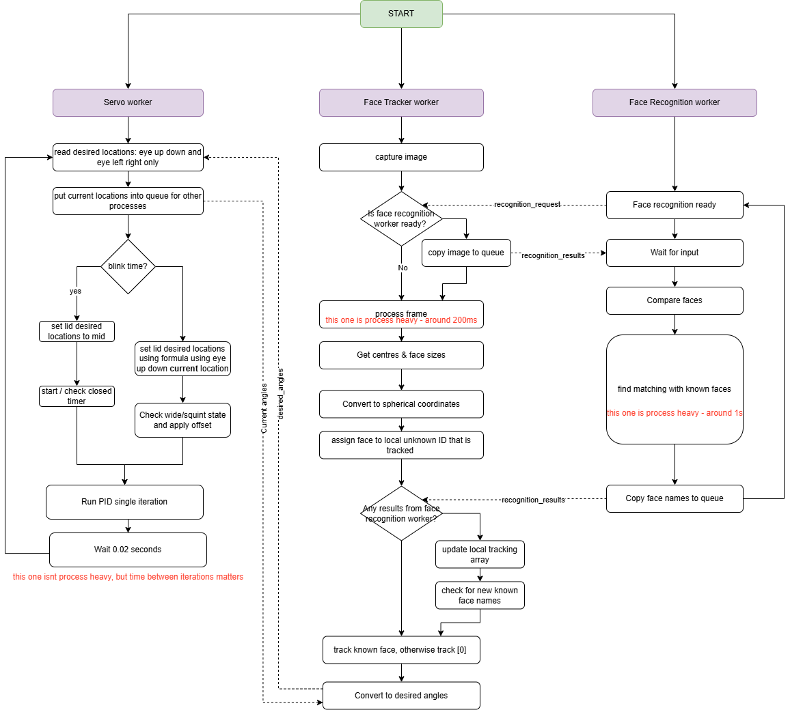

# animatronic_eyes
Code to run animatronic eyes with the RPi. 

This is still a work in progress!

# Setup
## Configure I2C
Configure your Pi with I2C:

```powershell
sudo apt-get install python-smbus
sudo apt-get install i2c-tools
```

Scan to see if you have port 1 or port 0 on your pi:
``` powershell
sudo i2cdetect -y 0
or
sudo i2cdetect -y 1
```

## Configure libraries
First create the virtual environment. Use `--system-site-packages` so you can use `picamera2`.
```bash
python3 -m venv --system-site-packages .venv
```
Activate the venv:
```bash
source .venv/bin/activate
```
Install additional libraries (`adafruit_ina228` and `adafruit_servokit`):
```bash
pip install -r requirements.txt
```

## Deploying onto RPi
For a dry run:
```bash
./deploy.sh --dry-run vicky eyepi.local /home/vicky/projects/eyes
```
For an actual copy: 
```bash
./deploy.sh vicky eyepi.local /home/vicky/projects/eyes
```
Sometimes you need to replace eyepi.local with an IP address. 

To get an IP address, open powershell:
```powershell
Resolve-DnsName eyepi.local
```

## Grabbing images off the RPi
```bash
./grab_images.sh vicky eyepi.local /home/vicky/projects/eyes
```
## Running
Navigate to /home/vicky/projects/eyes/scripts.
Ensure environment is activated. 
Run:
```bash
python main.py
```

# Design 
## Face detection model
Using from `face_detection_yunet_2023mar.onnx` from https://huggingface.co/opencv/opencv_zoo/blob/main/models/face_detection_yunet/face_detection_yunet_2023mar.onnx

Note this requires downloading the `.onnx` file and placing it on the Pi.

## Face recogition
Using face_recognition library for this. 

## System diagram

